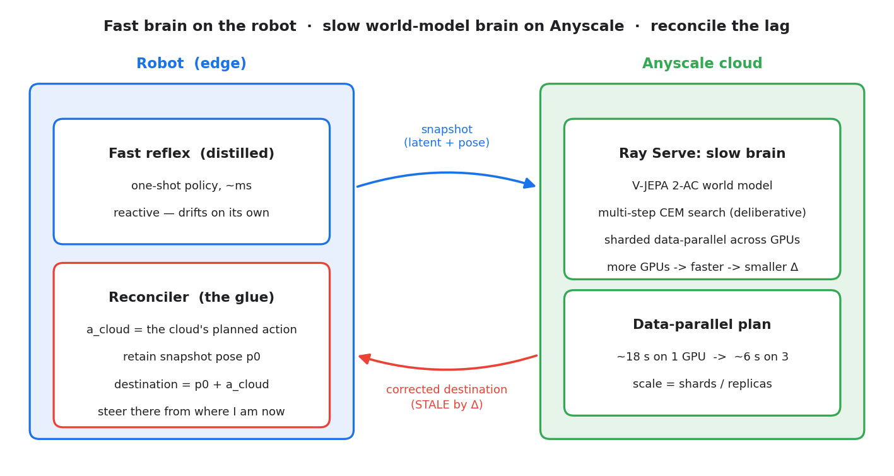

# Reconciling the Stale Cloud — test-time compute for Physical AI, on Anyscale

**A fast reflex on the robot; a slow, *deliberating* world-model brain on Anyscale; and the hard part —
reconciling the cloud's always-late advice with the robot's real-time motion.**

Today's robot policies (VLAs) are dazzling **reflexes**: observation → action in one shot. A reflex can't
*deliberate*. A **world model** — a learned model of *what happens next given an action* — lets a robot
**imagine and search** for a good action (test-time compute for control, the robotics analogue of the
"think longer, answer better" unlock behind o1-style reasoning). That search is heavy, so it belongs in
the cloud.

But the moment the thinking lives in the cloud, its answer is **always stale**: computed for where the
robot *was* when it asked, delivered seconds later, after the fast reflex has moved on. Naively applying
stale advice is *worse* than ignoring it. The unlock is **reconciliation**:

> Fuse the live reflex with the delayed cloud correction so the robot ends up where the cloud's smarter
> plan intended — starting from where it actually is *now*. It's the driving-with-GPS move: keep driving,
> and steer toward the destination the (slightly behind) GPS implies.

**This is a Ray + Anyscale workload end to end.** A *usable* plan needs a real search — heavy enough
(~18 s on one GPU) that it can't be served naively. So the slow brain is a **Ray Serve** deployment that
runs the search **data-parallel across GPUs** (sharding one plan's CEM batch), bringing it back in ~6 s.
More GPUs → faster plan → *less staleness to reconcile*. Scaling it is a config change, not a rewrite.



---

## What's here

Top-level is everything needed to **run** the notebook; `regen/` holds the scripts that **regenerate**
the figures/weights (not needed to run).

| File | Role |
|---|---|
| `world_model_reconciliation.ipynb` | **Start here.** Deploy the sharded slow brain on Ray Serve → a real cloud plan + real latency → live reconciliation (the reflex drifts, the stale cloud reply steers it back) → the seed-averaged results → data-parallel scaling. Runs in ~100 s. |
| `vjepa_core.py` | Ray-free core: load V-JEPA 2-AC, encode → latent, roll latents forward (dynamics), CEM-plan a chunk, score energy. |
| `slow_brain_service.py` | The cloud slow brain on **Ray Serve**. `build_sharded_app` fronts an HTTP `/plan` endpoint and runs each plan **data-parallel** across a pool of GPU `ShardWorker`s. |
| `sharded_planner.py` | **Data-parallel CEM**: one plan's sample batch sharded over `ShardWorker` actors, coordinator does global top-k + refit. This is what makes the heavy *usable* cloud fast enough to serve. |
| `world.py` | The `World` oracle — a stateful Ray actor standing in for physical reality (holds the true latent + pose; returns the pooled latent the reflex perceives). |
| `robot_client.py` | The on-robot **fast brain + reconciler** (numpy, no GPU): runs the distilled reflex every tick, and reconciles each stale cloud reply (`naive` vs `vector_add`). |
| `reflex_policy.py` / `reflex_policy.npz` | The **distilled fast reflex** at runtime — a one-shot MLP on the perceived latent → action — and its trained weights. |
| `regen/` | Regenerate assets / run headless: `distill_reflex.py` (→ `reflex_policy.npz`), `plot_money.py` (→ money chart), `make_architecture.py` (→ diagram), `p1_run.py`+`p1_world.py` (money-chart data), `p2_shard_test.py` (→ scaling chart), `run_nb.py` (execute the notebook). |
| `PLAN.md` | Full build plan, decisions log, and live status. |

## Substrate

[**V-JEPA 2-AC**](https://github.com/facebookresearch/vjepa2) (`vjepa2_ac_vit_giant`, MIT) — Meta's open,
action-conditioned video world model (ViT-g encoder + action-conditioned predictor), loaded from
`torch.hub`. Planning is the **Cross-Entropy Method** in latent space: sample action sequences, roll them
forward through the predictor, keep the ones whose imagined latent lands closest to a goal latent, refit,
repeat. Pure PyTorch — runs on the standard Anyscale base image plus a few prebuilt wheels.

## Two brains: reactive vs. deliberative

- **Fast brain (on the robot):** a **distilled reflex** — a small MLP that maps the perceived latent to
  an action in one forward pass (~ms, numpy, no GPU). It's a real learned policy, but *reactive*: it heads
  toward the goal yet, with no lookahead, **drifts off and can't hold**.
- **Slow brain (in the cloud):** the full **CEM search** — it *deliberates*, and with enough compute it
  reaches the goal. That's the value the reflex can't produce on its own; it's also why it's slow.

## The core mechanic (vector addition)

The cloud's action `a_cloud` was right for the **snapshot pose** `p0`. By the time it lands, the robot has
drifted to `p_now`.
- **Naive** — apply `a_cloud` from `p_now`. It carries the drift; error grows with latency.
- **Vector-add reconciliation** — the cloud implied a **destination** `p0 + a_cloud`. Steer from `p_now`
  toward it: `correction = (p0 + a_cloud) − p_now`. The drift cancels. (Requires *retaining* `p0` — captured
  when the request was sent — until the matching reply arrives; the robot reads its current pose live.)

## What it shows (measured on a 4× L4 dev cluster — illustrative)

| | result |
|---|---|
| Usable cloud plan | 128 × 6 × 2 CEM drives pose error **0.32 → ~0.05**; ~18 s on a single GPU |
| Served fast | sharded across 3 GPUs → **~6 s / plan (~3×)** — what makes the usable cloud servable in real time |
| Reflex alone | the distilled one-shot policy **drifts off (~0.6)** — reactive, can't hold |
| Reconciliation | as staleness Δ grows, **naive** climbs back toward the reflex baseline while **vector-add reconciled** stays low (~0.07–0.15 at Δ≥4). Pose-error, seed-averaged — `images/p1_feasibility.png` |
| Data-parallel CEM | one plan sharded across GPUs: **18.4 s → 4.3 s (4.28×) on 4 L4s** (`images/p2_shard_scaling.png`) |

> A 4× L4 dev cluster makes the latency gap deliberately stark, and the search is stochastic and
> under-resourced — the numbers are **illustrative demo results, not a benchmark**. On production
> accelerators (H100 / H200 / B200) the **same** Ray orchestration drops plan latency toward sub-second —
> the curves shift down and to the left. The fast brain still runs in ms on the robot.

## Δ is a dial (the production consideration)

Staleness Δ is the ratio of cloud latency to the robot's control period — a design dial, not a law. At the
notebook's moderate 2 Hz control loop, a ~6 s plan is ~12 ticks stale; a fast 10–50 ms loop makes the same
plan *hundreds* of ticks stale. You can shrink Δ (faster cloud via the shard lever / better GPUs) but never
to zero — the cloud is always slower than the reflex. So reconciliation is always needed, and matters
*more* as Δ grows.

## Setup & run

**Weights** (cached on shared storage so every worker loads locally):
```bash
export TORCH_HOME=/mnt/cluster_storage/torch_hub
python -c "import torch; torch.hub.list('facebookresearch/vjepa2', trust_repo=True)"
# fix the upstream placeholder URL in src/hub/backbones.py:
#   VJEPA_BASE_URL = "https://dl.fbaipublicfiles.com/vjepa2"   (not http://localhost:8300)
curl -o $TORCH_HOME/hub/checkpoints/vjepa2-ac-vitg.pt https://dl.fbaipublicfiles.com/vjepa2/vjepa2-ac-vitg.pt
```

**Run the notebook** top to bottom (deploys the sharded slow brain on Ray Serve, ~100 s end to end). To
execute it headless: `python regen/run_nb.py` (the environment's `jupyter nbconvert` is broken by an `lxml`
packaging split; `run_nb.py` uses `nbclient`). The notebook is edited **directly** — there is no generator
script to rebuild it from.

**Regenerate assets** (optional): `python regen/distill_reflex.py` (retrain the reflex →
`reflex_policy.npz`), `python regen/plot_money.py` (money chart), `python regen/make_architecture.py`
(diagram), `python regen/p1_run.py` (money-chart data sweep), `python regen/p2_shard_test.py` (scaling
chart).

## References

- V-JEPA 2 (Meta AI, 2024–2025) — `facebookresearch/vjepa2`, MIT.
- Cross-Entropy Method for model-predictive planning.
- o1-style test-time compute (the reasoning analogue this brings to control).
- Control under latency: teleoperation / networked control; the autonomous-driving off-vehicle-compute split.
