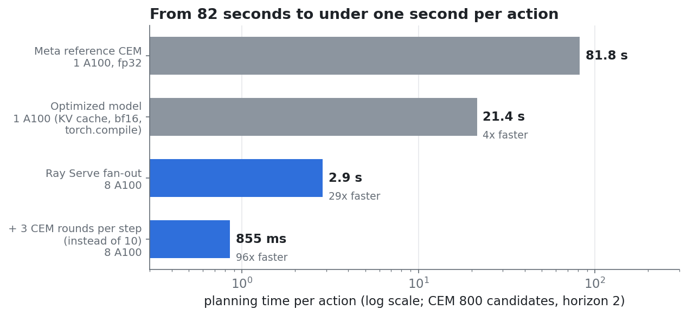
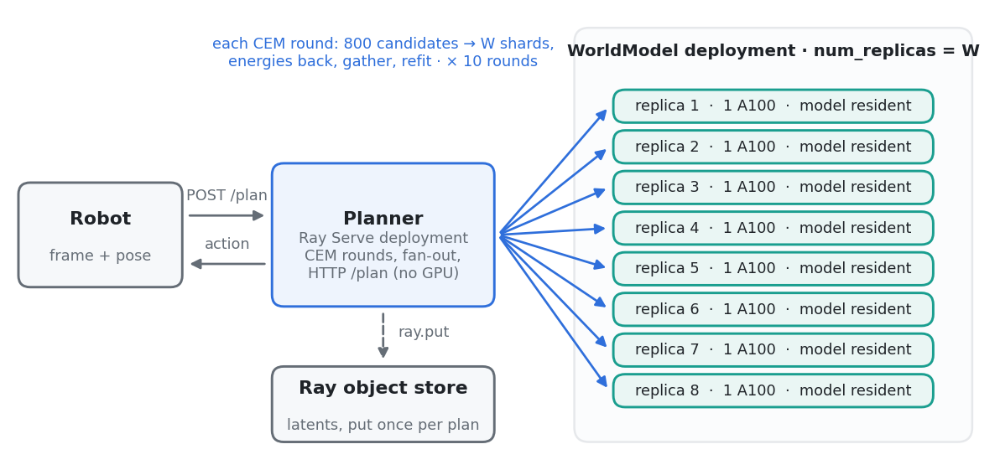

# Real-time planning with a JEPA world model on Ray

[V-JEPA 2-AC](https://github.com/facebookresearch/vjepa2) can steer a robot arm toward any goal image with no task-specific training. It does this by *searching*: each action comes from a Cross-Entropy Method (CEM) search that imagines thousands of futures with the world model. That search is slow: 16 s per action on an RTX 4090 per the paper, and **81.8 s** with Meta's reference planner on an A100.

This repo implements the two-deployment Ray Serve design from *Real-Time JEPA World Models* and measures it on one 8× A100-40GB node on Anyscale:

| | s / action | vs. reference |
|---|---|---|
| Meta reference CEM, 1× A100, fp32 | 81.8 | 1× |
| Optimized model (KV cache, bf16, `torch.compile`), 1× A100 | 21.4 | 4× |
| **Ray Serve fan-out, 8× A100** | **2.86** | **29×** |
| + 3 CEM rounds per step instead of 10 (same accuracy on our task) | **0.86** | **96×** |
| + non-blocking control | robot never waits (1.04 s steps for a 1 s motion) | |

CEM settings throughout: 800 candidates × 10 rounds, keep 80, horizon 2. Every number is measured; the raw data is in `results/`.

## Run it

**Start here:** `realtime_jepa_planning.ipynb`. It deploys the service on 8 GPUs, calls it over HTTP as a robot would, and runs a live non-blocking control episode. Execution takes about 4 minutes, plus a one-time ~12 GB download.

Requirements:
- A Ray cluster with 8 GPUs (≥ 40 GB each).
- Ray ≥ 2.58 with Serve.
- PyTorch ≥ 2.4.

The only extra package, `timm`, is installed per job through Ray's `runtime_env` (see `jepa_rt/__init__.py`). Set `TORCH_HOME` to shared storage so all GPUs read one copy of the checkpoint.

| Path | What |
|---|---|
| `realtime_jepa_planning.ipynb` | The walkthrough. |
| `jepa_rt/model.py` | V-JEPA 2-AC core (no Ray): `encode(frame)`, `score(candidates) -> energy`, `rollout`. Contains the fast path: KV cache across rollout steps, bf16, flash attention, `torch.compile`. |
| `jepa_rt/cem.py` | CEM as `sample` / `refit` / `plan` / `shift`, with the same rules as Meta's reference `cem()`. |
| `jepa_rt/serve_app.py` | The two Ray Serve deployments: `WorldModel` (GPU tier) and `Planner` (CEM driver, HTTP `/plan`). Scale with `build_app(n_gpus=W)`. |
| `scripts/check_fast_path.py` | Fast path vs reference check; times Meta's unmodified CEM. |
| `scripts/bench_compile.py` | `torch.compile` speedup on one GPU. |
| `scripts/bench_scaling.py` | Plan latency at 1/2/4/8 GPUs. |
| `scripts/bench_closed_loop.py` | Closed-loop episodes: 10 vs 3 rounds, cold vs warm-started. |
| `scripts/bench_nonblocking.py` | Blocking vs non-blocking control, in wall-clock time. |
| `scripts/make_figures.py` | `images/*.png` from `results/*.json`. |

## Lessons worth knowing

1. **Ship latents once per plan, not once per round.** One `ray.put` of the observation and goal latents. Replicas read them from shared memory and cache them on the GPU, so each round moves only ~5 KB of actions and returns energies. Ray's overhead per round is ~8 ms.
2. **Fan out one shard per GPU.** With `max_ongoing_requests=1`, Serve's default power-of-two-choices router occasionally put two shards on one replica, doubling that round. Serve's round-robin router fixed it: zero collisions in 50 rounds.
3. **`torch.compile` inside Serve.** Our replicas started with `TORCHDYNAMO_DISABLE=1` in their environment, which makes `torch.compile` a silent no-op. Pop it in the replica's `__init__` before importing torch.
4. **The 10 sequential rounds are the floor.** More GPUs shrink each round; to cut the number of rounds, tune them per task (3 were enough here) and overlap planning with motion (non-blocking control).

## Caveats

- The closed-loop experiments use the world model as the simulator (no physical arm), with a goal made reachable by rolling a known action sequence forward. They measure the planner, not real-world task success.
- The 32× H100 numbers in the notebook are a **projection**: the blog's latency model, calibrated on our measured A100 round.
- `TORCHDYNAMO_DISABLE=1` was present in Serve replica processes on our Anyscale workspace. It may come from the environment rather than from Ray itself.
